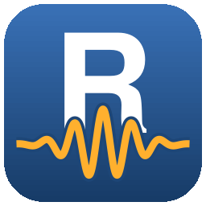
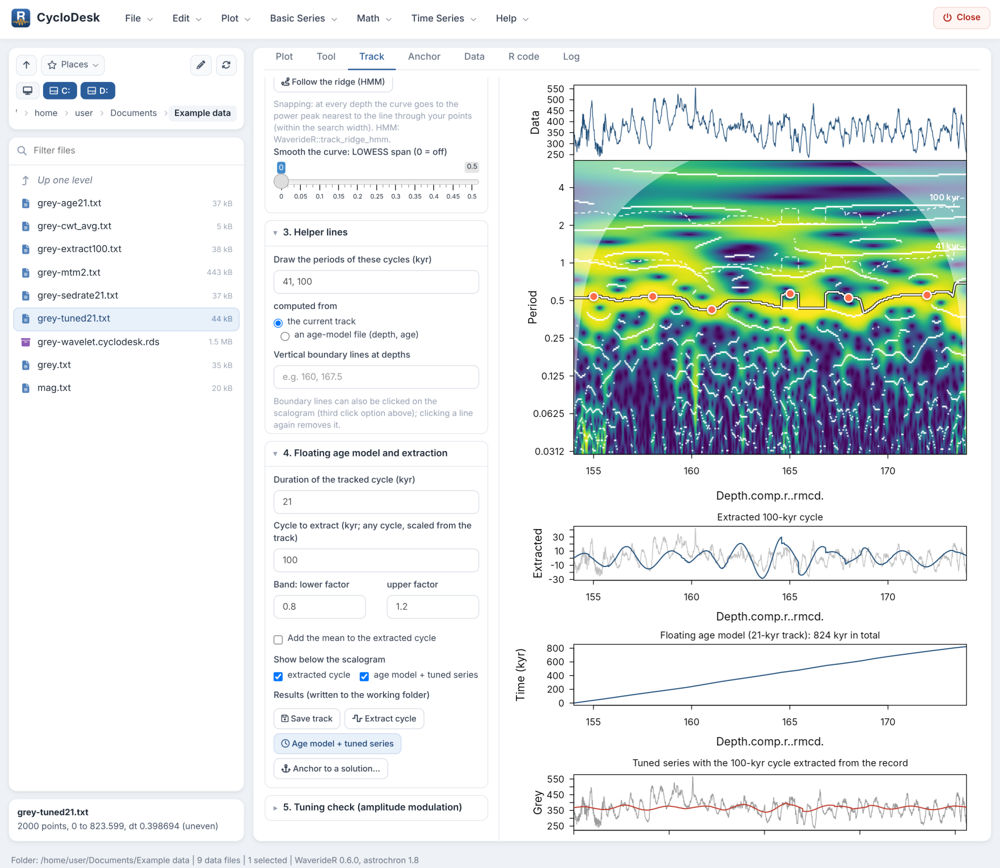
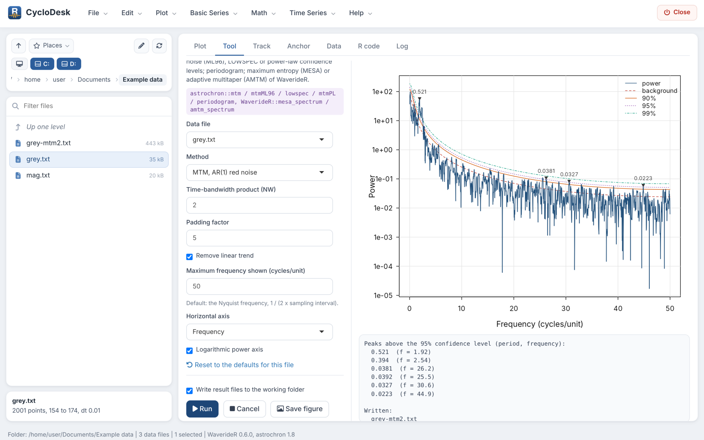
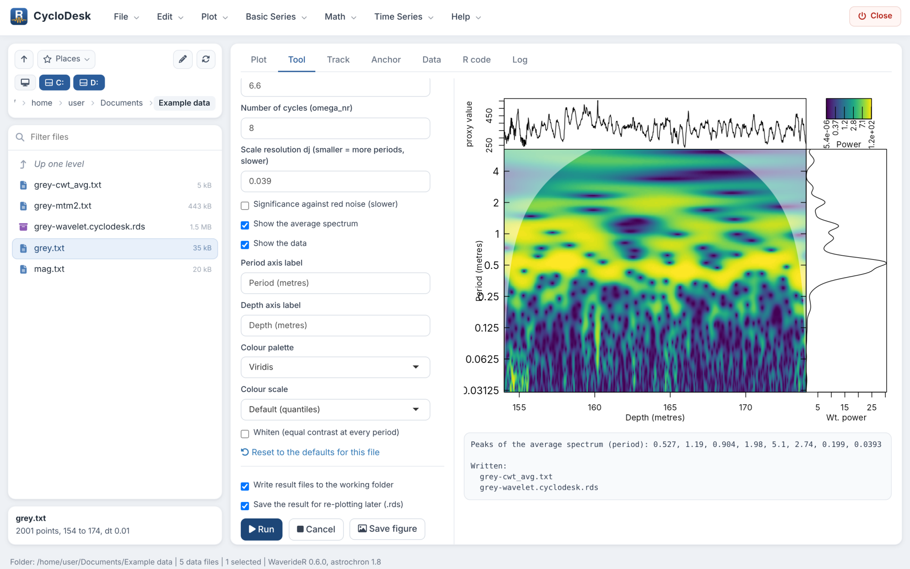
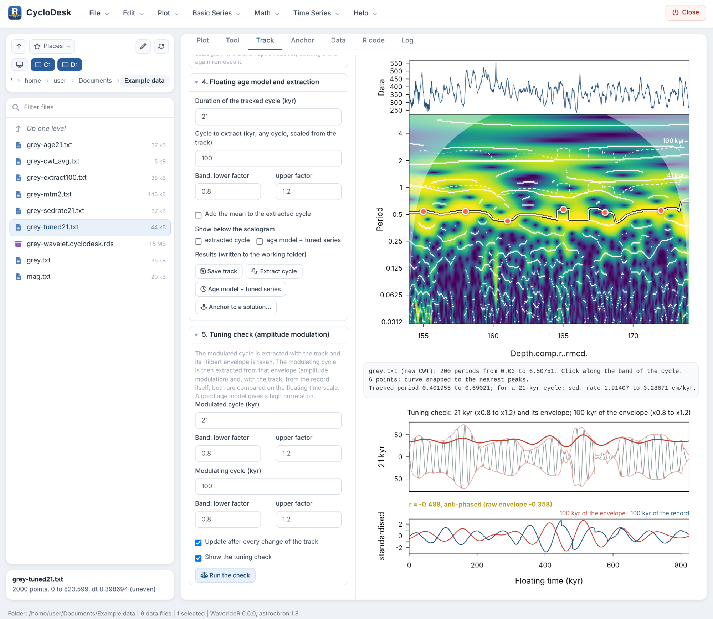
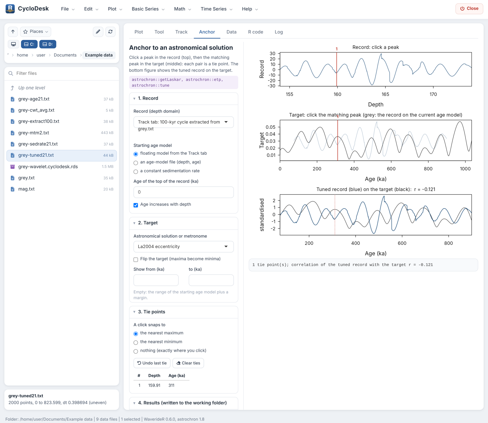

# CycloDesk 

[](https://github.com/stratigraphy/CycloDesk/blob/main/NEWS.md)
[](https://github.com/stratigraphy/CycloDesk/actions/workflows/R-CMD-check.yaml)
[-blue.svg)](LICENSE.md)

**A point-and-click workbench for cyclostratigraphy and paleoclimate time series, built on R.**

CycloDesk puts the R packages [WaverideR](https://github.com/stratigraphy/WaverideR) and
[astrochron](https://cran.r-project.org/package=astrochron) behind menus and buttons. Open a folder with your
data, pick a tool, press Run: spectra, wavelets, filters, cycle tracking, age models, tuning, TimeOpt and COCO,
without writing code. Every step writes its result as a plain text file next to your data and records the
equivalent R code, so anything you click can be repeated in a script.

It runs in your web browser, but on your own computer: your data never leaves your machine.

> **Status: alpha.** CycloDesk works and is being used for real records, but menus, defaults and file names
> may still change. Please [report](https://github.com/stratigraphy/CycloDesk/issues/new/choose) anything that
> breaks, looks wrong or is confusing. Feedback now shapes the first stable release.



## What it does

| Menu | Tools |
|---|---|
| **File / Plot** | Working-folder browser (drives, places, drag-and-drop), text, csv, Excel and LAS files; overlay, stacked and standardised plots, zoom, data table, sampling rate, data distribution |
| **Basic Series** | Astronomical solutions (La2004, La2010, La2011), insolation, ETP, signal and noise generator, example data |
| **Math** | Sorting, interpolation, selecting/removing parts (draggable lines), clipping, transformations, derivative, smoothing, Bayesian change points |
| **Time Series** | Detrending, pre-whitening; MTM, LOWSPEC, MESA, AMTM, SWA and other spectra; evolutive spectra; wavelets (22 mother wavelets), superlets and synchrosqueezing; coherence, cross wavelet, bispectral analysis; filtering, Hilbert amplitude, age models, tuning; TimeOpt/eTimeOpt, COCO/eCOCO; rho1, DYNOT, PDA, spectral moments |
| **Track** | Track a cycle on the scalogram by clicking (snap to peaks or free), follow the ridge (HMM) or snap the whole curve to the nearest peaks, LOWESS smoothing, helper lines for other cycles, floating age model, extraction of any cycle, tuning check against the amplitude modulation |
| **Anchor** | Tie a floating record to an astronomical solution, insolation or a metronome by clicking matching peaks |

Heavy calculations run in a separate R process, so the window stays usable and can cancel them. The **R code**
tab collects the code of every step; **Help > Which R function does what** lists the function behind each menu.

| | |
|---|---|
|  |  |
| Spectral analysis with confidence levels | Wavelet scalogram with average spectrum |
|  |  |
| Tuning check: envelope of a cycle against the modulating cycle | Anchoring a floating record to La2004 |

## Installation

### Windows, no R experience needed

1. Install R from <https://cloud.r-project.org/bin/windows/base/> (the default options are fine).
2. Download [**CycloDesk-launcher.zip**](https://github.com/stratigraphy/CycloDesk/releases/latest/download/CycloDesk-launcher.zip)
   and unzip it somewhere permanent, for example into `Documents\Apps` (not in Downloads). This gives a folder
   `CycloDesk`.
3. In that folder, double-click **SETUP.bat**. It installs CycloDesk, WaverideR and the other R packages it needs (a few
   minutes the first time) and puts a **CycloDesk** icon on your desktop.
4. Double-click the icon. CycloDesk opens in your browser.

CycloDesk checks once a day, at start-up, whether a newer version of CycloDesk or WaverideR is on GitHub and
installs it.

### From R (Windows, macOS, Linux)

```r
install.packages("remotes")
remotes::install_github("stratigraphy/WaverideR")   # always the newest WaverideR
remotes::install_github("stratigraphy/CycloDesk")
CycloDesk::run_app()                                # or run_app("path/to/your/data")
```

Both packages are pure R; no compilers or Rtools are needed.

## Getting started

The [tutorial](https://stratigraphy.github.io/CycloDesk/articles/getting-started.html) walks through a complete
analysis of the IODP Site 926 grey-scale record that comes with WaverideR: spectrum, wavelet, tracking the
eccentricity cycle, a floating age model, the tuning check and anchoring to La2004.

## Feedback and help

* **Something broken or wrong?** [Open a bug report](https://github.com/stratigraphy/CycloDesk/issues/new?template=bug_report.yml).
* **Missing a method or an idea for the interface?** [Suggest a feature](https://github.com/stratigraphy/CycloDesk/issues/new?template=feature_request.yml).
* **Questions, or want to show what you did with it?** Use the [Discussions](https://github.com/stratigraphy/CycloDesk/discussions).

Contributions are welcome; see [CONTRIBUTING.md](CONTRIBUTING.md).

## Citation

If CycloDesk helps your work, please cite it, together with the packages that do the calculations:

* Arts, M. (2026). CycloDesk: Graphical Interface for Cyclostratigraphy with WaverideR and astrochron. R package
  version 0.1.0. <https://github.com/stratigraphy/CycloDesk>
* Arts, M., Corradini, C., Pondrelli, M., Pas, D., Da Silva, A.-C. (2024). Age and orbital forcing in the upper
  Silurian Cellon section (Carnic Alps, Austria) uncovered using the WaverideR R package. Frontiers in Earth
  Science 12, 1357751. <https://doi.org/10.3389/feart.2024.1357751>
* Arts, M. (2023). WaverideR: Extracting Signals from Wavelet Spectra. R package.
  <https://CRAN.R-project.org/package=WaverideR>
* Meyers, S.R. (2014). Astrochron: An R Package for Astrochronology. <https://cran.r-project.org/package=astrochron>

plus the papers of the methods you used (listed in each tool's help panel). In R: `citation("CycloDesk")`.

## Acknowledgements

The menu layout and the working-folder workflow are inspired by [Acycle](https://github.com/mingsongli/acycle)
(Li, Hinnov and Kump, 2019, Computers & Geosciences 127, 12-22, <https://doi.org/10.1016/j.cageo.2019.02.011>).
CycloDesk contains no Acycle code; all calculations are done by WaverideR and astrochron.

## Licence

GPL (>= 2). See [LICENSE.md](LICENSE.md).
