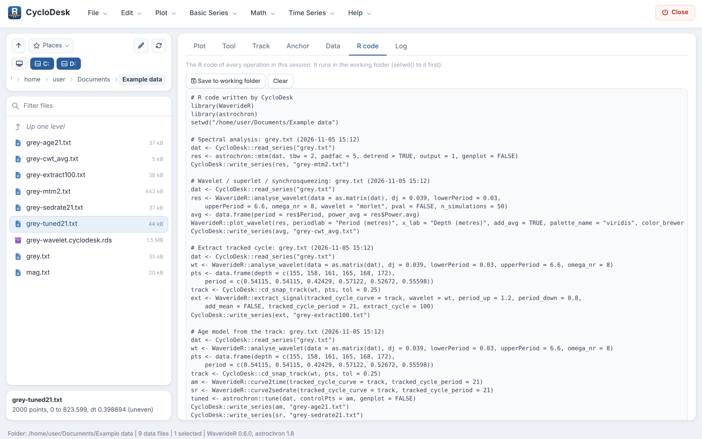

# Getting started: a complete analysis in CycloDesk

This walkthrough analyses the IODP Site 926 grey-scale record (154 to
174 m composite depth, Zeeden et al. 2013) that comes with WaverideR. It
takes about fifteen minutes and goes from the raw record to a floating
age model, a tuning check and an anchored age model. Every step writes
its result as a text file into your working folder and adds its R code
to the **R code** tab.

## 1. Start CycloDesk

With the Windows launcher, double-click the **CycloDesk** icon on the
desktop. From R:

``` r

CycloDesk::run_app()                      # starts in the last working folder
CycloDesk::run_app("C:/data/my_project")  # or in a given folder
```

The interface opens in your web browser but runs on your own computer.

## 2. Choose a working folder and load the example data

The panel on the left is the **working folder**. Click a folder to open
it, use the drive buttons and **Places** to jump elsewhere, or click a
part of the path. Make an empty folder for this tutorial with **File \>
New folder…** and open it.

Then choose **Basic Series \> Example data**, pick *IODP 926 grey scale
(Zeeden et al. 2013)* and press **Run**. The file `grey.txt` appears in
the folder. Click it to plot it; drag over the plot to zoom and
double-click to go back.


The working folder with the example data plotted

Your own data work the same way: text, csv (also with semicolons and
decimal commas), Excel and LAS files, with depth or time in the first
column. For tables with more columns, choose the column below the file
list.

## 3. Spectrum

Choose **Time Series \> Spectral analysis**. The defaults compute a
multitaper spectrum (MTM) with an AR(1) red-noise background and
confidence levels. Press **Run**.


Multitaper spectrum with red-noise confidence levels

The peaks above the 95 % level are listed below the figure. The
strongest are at about 0.52 m and 0.39 m: the precession band. WaverideR
documents the 0.4 to 0.55 m band of this record as the ~22 kyr
precession cycle, which means a sedimentation rate of roughly 2 cm/kyr.
The spectrum is written as `grey-mtm2.txt`.

## 4. Wavelet scalogram

Choose **Time Series \> Wavelet / superlet / synchrosqueezing** and
press **Run**. The scalogram shows how the period of each cycle changes
with depth, which a single spectrum cannot. Try other colour palettes,
the colour scale, or *Whiten* to give weak and strong cycles the same
contrast.


Wavelet scalogram with the average spectrum

The result is saved as `grey-wavelet.cyclodesk.rds`; double-click it
later to re-plot it without recomputing.

## 5. Track the precession cycle

Choose **Time Series \> Track a cycle by hand on the scalogram**.
Section 1 already selects the scalogram you just computed; press **Show
scalogram**.

In section 2, click points along the bright band at about 0.5 m, from
the top to the bottom of the record. With *snapped to the nearest power
peak* every click jumps to the band. Click a point to select it, drag it
to move it, and press Delete or Backspace to remove the selected points.
Then complete the curve:

- **Snap the whole curve to the nearest peaks** follows the band at
  every depth, guided by your points;
- **Follow the ridge (HMM)** follows it with a hidden Markov model;
- **Smooth the curve** (LOWESS) removes jumps between neighbouring
  peaks.

In section 3 (*Helper lines*) type `41, 100`: the periods that obliquity
and short eccentricity would have with this track are drawn on the
scalogram. If the track is right, these lines follow bands of their own.

## 6. Floating age model and the extracted cycle

In section 4, set *Duration of the tracked cycle* to `21` and *Cycle to
extract* to `100`. Then:

- **Extract cycle** writes the 100-kyr cycle, scaled from the track, as
  `grey-extract100.txt` and shows it below the scalogram;
- **Age model + tuned series** writes the floating age model
  (`grey-age21.txt`), the sedimentation rate (`grey-sedrate21.txt`) and
  the tuned record (`grey-tuned21.txt`), and shows the age model and the
  tuned record with the extracted cycle on top.


Tracking, extracted cycle, floating age model and tuned series

With *Show below the scalogram* you can hide these panels again.

## 7. Tuning check

If the age model is right, the amplitude of precession should be
modulated by eccentricity. In section 5, set *Modulated cycle* to `21`
and *Modulating cycle* to `100`, and press **Run the check**. CycloDesk
extracts the 21-kyr cycle with the track, takes its Hilbert envelope,
extracts the 100-kyr cycle from that envelope, and compares it with the
100-kyr cycle extracted from the record itself, both on the floating
time scale.


Tuning check: the envelope of precession against eccentricity

The correlation r is shown above the lower panel. A strong negative r is
also a good result: the proxy then responds inversely to eccentricity.
The band factors set the width of each extracted band. With *Update
after every change of the track* on, the check reruns whenever you move
a point, so you can improve the track and watch r.

## 8. Anchor to an astronomical solution

Press **Anchor to a solution…** in section 4. The Anchor tab opens with
the extracted 100-kyr cycle as the record and the floating age model as
the starting model. Choose *La2004 eccentricity* as the target and set
*Age of the top of the record* to an approximate age from your
biostratigraphy or magnetostratigraphy.

Click a peak in the record (top), then the matching peak in the target
(middle). One tie point shifts the floating model; two or more give a
piecewise-linear age model that keeps the floating sedimentation rates
beyond the outer ties. The bottom panel shows the tuned record on the
target with its correlation. **Age model + tuned series** writes the
anchored age model, the tuned record and the tie points.


Anchoring the extracted cycle to La2004 eccentricity

Anchoring needs independent age control: a good correlation with the
wrong eccentricity cycle looks just as convincing as with the right one.

## 9. Repeat it in R

The **R code** tab holds the code of every step: reading the file, the
WaverideR or astrochron call and writing the result. Save it with **Save
to working folder** to repeat or adapt the analysis in a script.



The R code of the session

## Feedback

CycloDesk is in alpha. If something did not work as described here, or a
method you need is missing, please [open an
issue](https://github.com/stratigraphy/CycloDesk/issues/new/choose) or
start a
[discussion](https://github.com/stratigraphy/CycloDesk/discussions).

## References

Zeeden, C., Hilgen, F., Westerhold, T., Lourens, L., Röhl, U., Bickert,
T. (2013). Revised Miocene splice, astronomical tuning and calcareous
plankton biochronology of ODP Site 926 between 5 and 14.4 Ma.
Palaeogeography, Palaeoclimatology, Palaeoecology 369, 430-451.
<https://doi.org/10.1016/j.palaeo.2012.11.009>
